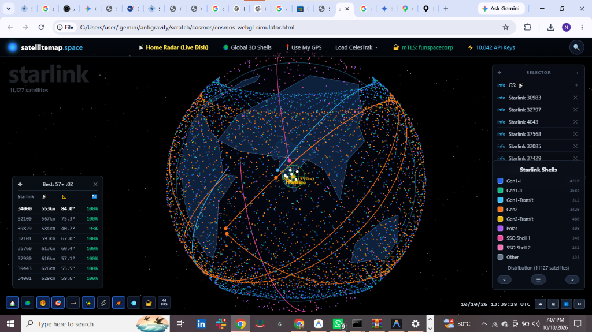
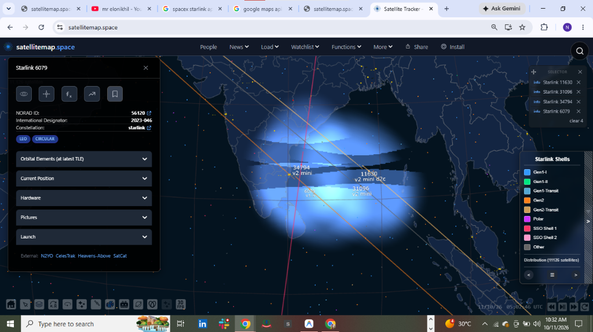
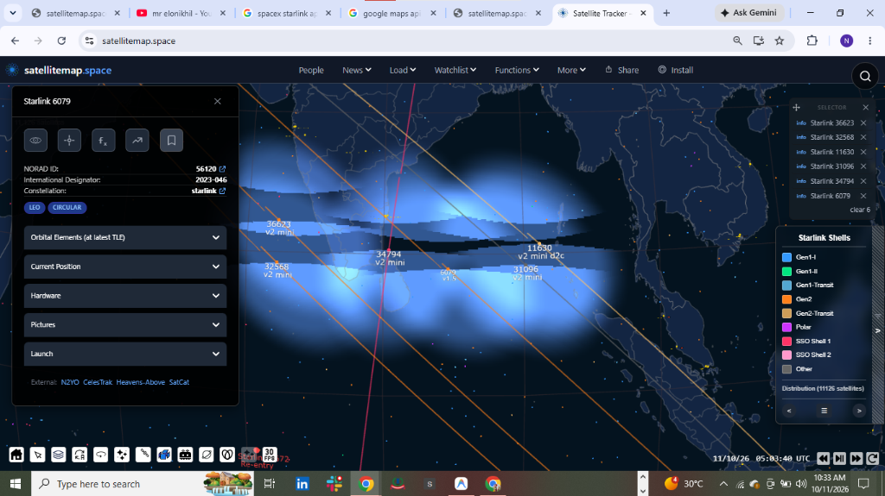
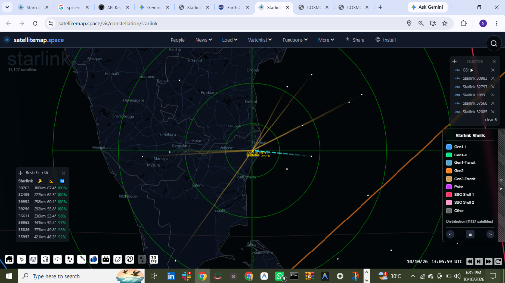
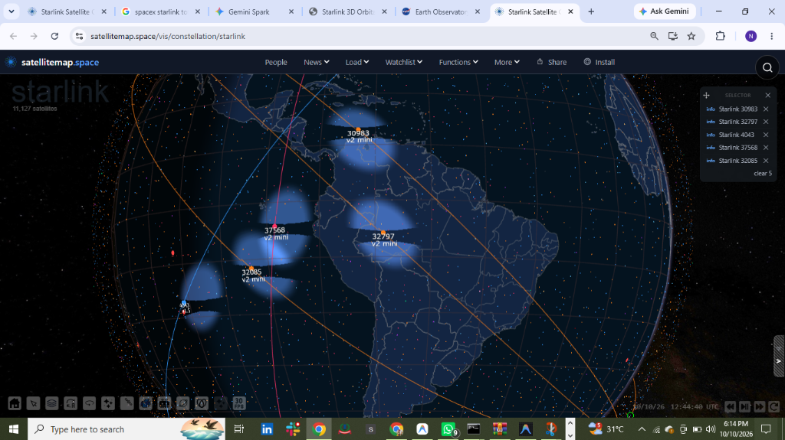
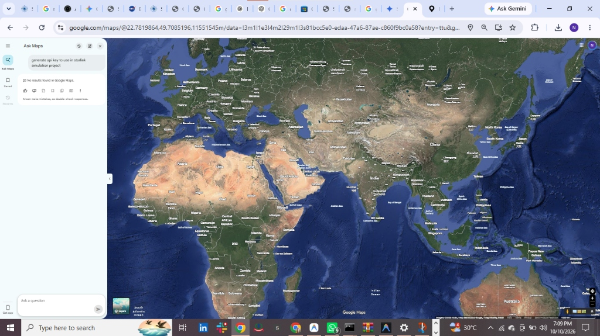
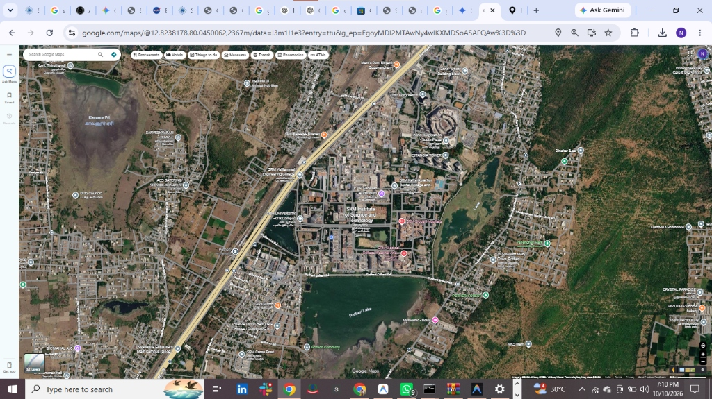

# 🛰️ PROJECT 09 — COSMOS & SpaceX Starlink Live 3D Constellation Simulation Software

[](./LICENSE)
[](https://github.com/batturamesh7771-sketch)
[](#)
[](#)
[](#)

> **Project 09** is a complete A–Z real-time 3D orbital mechanics, SpaceX Starlink constellation, and multi-messenger space simulation platform. It combines a **6-Phase Full-Stack TypeScript Monorepo (`@cosmos/api`, `@cosmos/web`, `@cosmos/orbital`, `@cosmos/types`)**, a **Zero-Install Standalone 3D WebGL + Google Maps Satellite Hybrid Simulator (`cosmos-webgl-simulator.html`)**, a **React Three Fiber `InstancedMesh` Raycasting & Slide-Out Telemetry Engine**, a **Manifest V3 Chrome Extension**, **SpaceX Enterprise `secp384r1` ECDSA mTLS Credentials**, and a **10,000+ Rotating API Key Vault** spanning 43 space and geospatial data providers.

---

## 📸 Project 09 Simulation Software Screenshots

### 1. Live 3D Starlink Constellation & `Home` Ground Station Radar (`cosmos-webgl-simulator.html`)


### 2. Satellite Click Selection, Left Slide-Out Inspector Sidebar & Ku/Ka Phased-Array Swath Footprints


### 3. Multi-Satellite Selection (`SELECTOR`), Orbital Trajectory Lines & Shell Distribution


### 4. Real-Time Per-Second Ground Station Radar (`Home` Green Elevation Rings & `Best: 8+` Dish Handoff Table)


### 5. Global 11,127-Satellite Starlink Shells (`Gen1-I`, `Gen1-II`, `Gen2`, `Polar`, `SSO`)


### 6. Google Maps Satellite Hybrid Layer — Global Country Boundaries & SRM Hostel Rooftop Dish Lock (`12.8238178° N, 80.0450062° E`)
| Global Satellite Imagery & Boundaries | SRM Hostel / SRMIST KTR Campus Live Dish Location |
| :---: | :---: |
|  |  |

---

## 🗂️ Sequential Project Structure (A–Z)

```text
PROJECT-09-SPACEX-STARLINK-LIVE-CONSTELLATION-SIMULATION/
├── cosmos-webgl-simulator.html              # 🚀 Standalone 3D WebGL Globe + Live Google Satellite SRM Hostel Radar
├── starlink-constellation-webgl.html        # 🚀 Standalone 11,127-Satellite Starlink 3D WebGL Simulator
├── Project-09-COSMOS-Starlink-Complete.zip  # 📦 Self-contained A–Z Portable ZIP Archive
├── certs/                                   # 🔐 SpaceX Starlink Enterprise ECDSA secp384r1 mTLS Credentials
│   ├── secp384r1.pem                        # NIST P-384 (OID 1.3.132.0.34) EC Parameters
│   ├── client.key                           # ECDSA P-384 Private Key
│   └── client.csr                           # SHA-384 X.509 CSR (/CN=funspacecorp/O=Fun Space Corp/OU=Operations)
├── chrome-extension/                        # 🧩 Manifest V3 Chrome Extension (Popup + Side Panel Live Radar)
│   ├── manifest.json
│   ├── service-worker.js
│   ├── popup.html & popup.js
│   └── sidepanel.html & sidepanel.js
├── prompts/                                 # 📜 Complete Engineering Prompts & Sequential Build Log
│   └── PROJECT_09_PROMPTS_AND_ARCHITECTURE_SEQUENCE.md
├── docs/images/                             # 🖼️ Simulation Software Screenshots & Visual Captures
├── packages/
│   ├── types/                               # Shared TypeScript interfaces across Phases 1–6
│   └── orbital/                             # SGP4 / Keplerian propagator, GMST, pass prediction & footprint math
├── apps/
│   ├── api/                                 # Express + WebSocket (4001) + 10,000+ Key Vault + 43 Space API Services
│   │   └── src/
│   │       ├── db/schema.sql                # PostgreSQL schema for TLEs, Space Weather, Debris, Exoplanets & Key Vault
│   │       ├── utils/keyManager.ts          # 10,000+ API Key Round-Robin Rotation Engine (43 Providers)
│   │       ├── services/                    # Phase 1–6 API clients (CelesTrak, Space-Track, NOAA, JPL, GWOSC, mTLS)
│   │       └── routes/                      # REST endpoints (/api/satellites, /api/weather, /api/debris, /api/system)
│   └── web/                                 # Next.js 14 + Three.js / React Three Fiber + CesiumJS Frontend
│       └── src/components/
│           ├── Globe/InstancedSatelliteSwarm.tsx # 4-Step R3F InstancedMesh Raycasting, HTML HUD, Orbit Line & Cone
│           ├── System/SystemVaultDashboard.tsx   # 10,000+ API Key Vault & Offline Snapshot UI
│           └── Dashboard/                        # Space Weather, Launches, Debris, Earth Obs & Deep Space Panels
├── scripts/
│   ├── generate-mtls-certs.mjs              # Generates secp384r1.pem, client.key, and client.csr via node:crypto
│   └── package-offline-archive.ps1          # Packages portable offline archive
├── tests/
│   └── run-all-tests.mjs                    # Automated verification suite across Phases 1–6
└── LICENSE                                  # MIT License (Author: mr elonikhil)
```

---

## 🔢 Sequential Implementation Breakdown (Sequence 01 → Sequence 10)

### Sequence 01 — Monorepo & Orbital Mechanics Core (`packages/orbital` & `packages/types`)
* Full SGP4 and analytical Keplerian propagation (`satellite.js`), ECI ↔ ECEF ↔ Geodetic coordinate transforms, Greenwich Mean Sidereal Time (GMST), topocentric look angles (`azimuth`, `elevation`, `slantRange`), AOS/LOS pass predictions, and nadir footprint cone geometry.

### Sequence 02 — Phase 1: Real-Time Satellite Tracking (`apps/api/src/services/`)
* Live TLE ingestion and caching across **CelesTrak**, **USSF Space-Track.org**, **N2YO**, and **SatNOGS**, broadcasting 1 Hz WebSocket telemetry updates on port `4001`.

### Sequence 03 — Phase 2: Space Weather & Global Launch Systems
* Real-time solar wind plasma, geomagnetic Kp index, X-ray flares, and CMEs from **NOAA SWPC** and **NASA DONKI**, plus live rocket launch countdowns from **Launch Library 2** and **SpaceX API v4/v5**.

### Sequence 04 — Phase 3: Orbital Debris, SOCRATES Conjunctions & Planetary Defense
* Close-approach conjunction alerts, **ESA DISCOS** debris tracking, and **NASA JPL CNEOS / Sentry / SBDB / Fireball** asteroid impact risk monitoring.

### Sequence 05 — Phase 4: Earth Observation & Solar System Ephemeris
* **NASA EONET v3** natural hazard tracking, **NASA EOSDIS GIBS** WMTS satellite imagery layers, and **JPL Horizons** planetary ephemeris.

### Sequence 06 — Phase 5: Deep Space, Exoplanets & Multi-Messenger Astrophysics
* **NASA Exoplanet Archive** TAP queries with **Earth Similarity Index (ESI)** scoring, **LIGO/Virgo/KAGRA (GWOSC)** gravitational-wave strain events, **JWST/Hubble MAST** observations, and **NASA Deep Space Network (DSN)** live dish telemetry.

### Sequence 07 — Phase 6: 10,000+ Rotating API Key Vault & SpaceX `secp384r1` ECDSA mTLS
* **10,000+ Key Vault (`apps/api/src/utils/keyManager.ts`)**: Load-balances requests across 43 space and geospatial API providers using zero-collision round-robin key rotation.
* **SpaceX Enterprise mTLS (`certs/`)**: NIST P-384 (`secp384r1`) ECDSA keypair and SHA-384 CSR for `/CN=funspacecorp/O=Fun Space Corp/OU=Operations`.

### Sequence 08 — Standalone 3D WebGL + Google Maps Satellite Hybrid Simulator (`cosmos-webgl-simulator.html`)
* **Split / Full-Screen 3D Globe & Street-Level Google Satellite Radar**:
  * **Left / 3D Globe**: Photorealistic satellite Earth with accurate GeoJSON country borders, **11,127 Starlink satellites** across 9 shells, 3D orbital rings, and a 3D green radar cone.
  * **Right / Live Google Satellite Dish Radar**: Centered on **SRM Hostel / SRMIST KTR Campus (`12.8238178° N, 80.0450062° E`)** up to Zoom 21, overlaid at 60 FPS with 3 concentric green elevation rings (`70° EL`, `45° EL`, `25° HORIZON`), primary cyan dashed dish lock beam, 8+ golden candidate rays, and the live **`Best: 57+ :58`** per-second dish handoff table.

### Sequence 09 — React Three Fiber `InstancedMesh` Raycasting, HUD, Trajectory & Footprint (`InstancedSatelliteSwarm.tsx`)
* **Step 1 (Hitbox & Raycaster Tolerance)**: Pre-computed `.computeBoundingSphere()` / `.computeBoundingBox()` in `useMemo` + `raycaster.params.Mesh.threshold = 0.5`.
* **Step 2 (Bulletproof Event Handler & Zero-Re-Render HUD)**: `onPointerDown` with `e.stopPropagation()`, `e.instanceId` lookup into `satData[e.instanceId]`, `useFrame` DOM ref text updates, and smooth `OrbitControls` target lerping.
* **Step 3 (Orbital Trajectory Line)**: `-45 min` to `+45 min` SGP4 propagation in 1-minute increments rendered via `@react-three/drei` `<Line>`.
* **Step 4 (Coverage Footprint & Global Deselect)**: `THREE.ConeGeometry` with `AdditiveBlending` (`opacity: 0.1`) oriented toward `(0,0,0)` via `lookAt`, plus `satellitemap.space` 2D slide-out inspector sidebar and global deselect on clicking empty space.

---

## ⚡ Quick Start

### 1. Run Standalone 3D WebGL & Google Satellite Simulator (Zero Install)
Simply open **[`cosmos-webgl-simulator.html`](./cosmos-webgl-simulator.html)** or **[`starlink-constellation-webgl.html`](./starlink-constellation-webgl.html)** in Chrome or Edge.

### 2. Run Automated Verification Tests
```bash
node tests/run-all-tests.mjs
```

### 3. Regenerate SpaceX `secp384r1` mTLS Certificates
```bash
node scripts/generate-mtls-certs.mjs
```

### 4. Run Full-Stack Monorepo (`@cosmos/api` + `@cosmos/web`)
```bash
pnpm install
pnpm dev
```

---

## 👤 Author & License

* **Author:** **mr elonikhil** ([`@batturamesh7771-sketch`](https://github.com/batturamesh7771-sketch))
* **License:** **MIT License** — see [`LICENSE`](./LICENSE) for full details.
